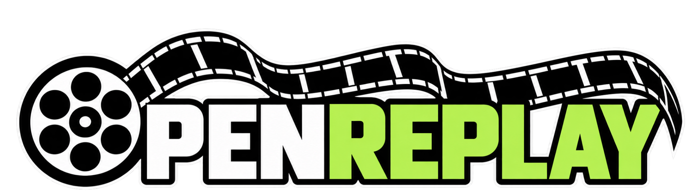

<div align="center">
  

  # OpenReplay

  **A free, open-source, account-free Counter-Strike 2 tactical demo reviewer.**

  Review a CS2 match from above: follow every player, replay rounds, inspect kills and utility, analyze timing, and annotate the map—all in your browser using a local application.

  **[Get started](#quick-start-windows)** · **[Everything you can do](#features-at-a-glance)** · **[Controls](#keyboard-and-mouse-shortcuts)** · **[Privacy](#privacy-and-data-handling)** · **[Troubleshooting](#troubleshooting)**
</div>

---

> **Current release:** This README describes the **secure local OpenReplay application based on v26**. It launches a Python server on **your computer** and opens a browser interface at `127.0.0.1`. It is **not** a fully static, browser-only WebAssembly app, and it does **not** require Steam, Faceit, or an OpenReplay account. See [Local vs. website versions](#local-versus-website-versions).

## Contents

- [What is OpenReplay?](#what-is-openreplay)
- [Quick start (Windows)](#quick-start-windows)
- [Requirements and supported files](#requirements-and-supported-files)
- [Features at a glance](#features-at-a-glance)
- [Your first replay](#your-first-replay)
- [Interface guide](#interface-guide)
- [Playback and round navigation](#playback-and-round-navigation)
- [Match timeline and player tracking](#match-timeline-and-player-tracking)
- [The 2D radar](#the-2d-radar)
- [Map camera, selection, and drawing](#map-camera-selection-and-drawing)
- [Dual-floor maps](#dual-floor-maps)
- [Kills, the event dock, and the killfeed](#kills-the-event-dock-and-the-killfeed)
- [Grenades and utility analysis](#grenades-and-utility-analysis)
- [Bomb tracking and defusing](#bomb-tracking-and-defusing)
- [Scoreboard, player stats, and loadouts](#scoreboard-player-stats-and-loadouts)
- [Scores and round-win conditions](#scores-and-round-win-conditions)
- [Keyboard and mouse shortcuts](#keyboard-and-mouse-shortcuts)
- [Privacy and data handling](#privacy-and-data-handling)
- [Known limitations and accuracy](#known-limitations-and-accuracy)
- [Troubleshooting](#troubleshooting)
- [Running from source / developing](#running-from-source--developing)
- [Local versus website versions](#local-versus-website-versions)
- [Contributing, security, and license](#contributing-security-and-license)

## What is OpenReplay?

OpenReplay is a **2D Counter-Strike 2 demo viewer** designed for players, teams, coaches, and anyone who wants to understand what happened in a match without watching ten separate first-person perspectives.

Load a CS2 `.dem` recording and examine player rotations, positions, engagements, equipment, utility, timing, and individual performances. You can review the entire match or focus on one round, one player, a group of players, or a specific grenade or elimination.

The local version uses a Python service to parse the demo on your own machine, then displays the replay in a browser using HTML, CSS, JavaScript, and a 2D canvas. **It does not require a game client, an account, or a Steam/Faceit sign-in.**

## Quick start (Windows)

1. **Download** the latest **Local** release from this project's [GitHub Releases](../../releases) page, or download the repository as a ZIP.
2. **Extract** the archive to a normal folder, such as `Desktop\OpenReplay`. Do not run it from inside the ZIP file.
3. Install **64-bit Python 3.11, 3.12, or 3.13** (`3.13` recommended; Python `3.14+` is not yet supported by the pinned binary packages) if it is not already installed. Ensure that `python` or the Windows `py` launcher is available.
4. Inside the extracted `OpenReplay` folder, double-click **`start_windows.bat`**.
5. On first launch, OpenReplay creates a local `.venv` and installs its Python dependencies. This requires an internet connection. Later launches reuse that environment unless the requirements change.
6. Your browser should open automatically. If it does not, copy the exact URL shown in the terminal; for example, **`http://127.0.0.1:8765`**.
7. Select **Open .dem file**, drag a recording onto the page, or choose **Try the sample playback** to explore the controls.

**Keep the terminal window running while reviewing demos.** Closing it stops the local server. To exit, return to the terminal and press **Ctrl+C**.

> **Important:** OpenReplay searches for an available localhost port from `8765` through `8790`. If another version is running on `8765`, the new copy may open on `8766` or another port. Always use the URL printed by the version you just launched—otherwise your browser might show an older release.

## Requirements and supported files

| Item | Details |
| --- | --- |
| Operating system | **Windows** has the included one-click launcher. Other systems may run from source with Python, but the Windows experience is the packaged path. |
| Python | **64-bit CPython 3.11–3.13** (`3.13` recommended) with support for virtual environments. |
| Browser | A modern desktop browser with JavaScript, Canvas, and local file selection. |
| Recording | A **Counter-Strike 2 Source 2 `.dem`** file. Legacy CS:GO demos are not promised to work. |
| Demo size | The local server's default maximum upload size is **900 MB**; this is configurable by the operator. |
| Internet | Needed for first-time Python dependency installation. Radar-map artwork and metadata may be downloaded on demand. |
| Hardware | CPU and available RAM affect parsing time, especially for long or unusually large demos. |

OpenReplay runs in your browser, but the **demo parser is a local Python process**. Opening the HTML file directly without starting the server is not sufficient.

## Features at a glance

| Area | What you can do |
| --- | --- |
| **Demo loading** | Open or drag-and-drop a `.dem`, view upload progress, and try a fictional sample match. |
| **Match playback** | Play/pause, seek anywhere, skip 5 seconds, switch rounds, and choose **0.25×, 0.5×, 1×, 2×, or 4×** speed. |
| **Match timeline** | Scrub the full match or current round, zoom and pan through time, jump to kill/utility ticks, and track specific players independently. |
| **2D radar** | Follow CT/T positions, names, health, facing direction, firing flashes, death markers, grenades, and C4. |
| **Map navigation** | Scroll to zoom, drag to pan, use +/- buttons, reset the camera, select players in a rectangle, and draw annotations. |
| **Multi-floor maps** | View upper and lower floors stacked, or switch to a layered view with Upper/Lower selection. |
| **Kills** | Inspect exact kill ticks, death locations, weapon names, kill modifiers, assists, and the live killfeed. |
| **Utility** | See recorded grenade flight paths, deployed effects, damage, flash durations, active countdowns, and player/type filters. |
| **Scoreboard** | See players' stats, health, full recorded loadouts, round kill totals, C4 ownership, team names, and sortable columns. |
| **Bomb** | See carried/dropped/planted C4, explosion timer, and a kit-aware defuse countdown. |
| **Rounds and scores** | View live and final scores, round clocks, and color-coded win conditions. |

## Your first replay

### Load a recording

Use any of the following:

- Click **Open .dem file** in the left panel.
- Click **Select demo file** in the empty radar view.
- **Drag and drop** a `.dem` file onto the page.
- Click **Try the sample playback** to explore without a real demo. The sample contains **fictional data** and must not be treated as a real-match analysis.

The progress indicator shows the actual upload percentage while the file is transferred to the local service, followed by a separate processing/loading status. **Parsing time is not an exact percentage**, because the underlying parser does not provide one.

Once loaded, the round list, radar, timeline, event dock, and scoreboard are populated. Open another demo at any time to start a new replay and reset the previous replay's selections.

### Typical review workflow

1. Pick a **round** from the left sidebar.
2. Press **Space** or the Play button to watch players move.
3. Click a **K/D event** or utility marker to jump directly to the action.
4. Select one or more **scoreboard players** to focus the radar on them.
5. Use **Timeline players** to track a different set of players on the event timeline without changing the radar.
6. Slow to **0.25×**, zoom in, and inspect the engagement or grenade path.
7. Use **Ctrl+drag** to annotate a rotation or **Shift+drag** to select a group on the radar.

## Interface guide

| Location | What's there |
| --- | --- |
| **Left sidebar** | Open-demo control, current filename, upload progress, complete round list, round-win indicators, and shortcut reminders. |
| **Top bar / viewer toolbar** | Map and replay status, **current/final score**, round clock, round selector, and radar display toggles. |
| **Center** | Interactive 2D map, active utility status on the left, recent killfeed on the right, zoom controls, map coordinates, and radar shortcuts. |
| **Below the radar** | **Kill Events / Utility** event dock with selectable cards and utility impact details. |
| **Bottom timeline** | Match or current-round time range, event markers, player filter, zoom/pan controls, scrubber, playback buttons, and speed selector. |
| **Right sidebar** | CT and T rosters, player selection, sortable statistics, health, round kills, full known equipment, and C4 carrier. |
| **Help (`?`)** | In-app explanation of the main controls and replay behavior. |

## Playback and round navigation

### Playback controls

- **Play / Pause:** Start or stop the replay at the current tick.
- **Back / Forward 5 seconds:** Review a short sequence again or skip ahead.
- **Previous / Next Round:** Jump between round starting points.
- **Speed:** Select **0.25× / 0.5× / 1× / 2× / 4×** at the bottom-right of the timeline.
- **Seek slider:** Drag the playhead to a specific moment. Seeking backward correctly restores earlier states for kills, players, utility, and timers.
- **Elapsed / total time:** Monitor your place in the recording.

### Pick a round

Use either the **Match Rounds** list in the left sidebar or the **Round** dropdown above the radar. Round selections work while the replay is playing or paused.

The round list shows **Round 01, Round 02, ...** with a single win-condition symbol colored for the winning side. See [Scores and round-win conditions](#scores-and-round-win-conditions).

## Match timeline and player tracking

The timeline is designed for both broad match review and frame-by-frame-style navigation around important events.

### Full Match or Current Round

Click the adjacent **Full match** and **Current round** buttons:

- **Full match:** Shows the entire recording with round divisions and all matching event markers.
- **Current round:** Restricts the timeline to the round under review, automatically following round changes. Timeline zoom and pan stay within that round.

You can switch modes without changing the radar's player filter.

### Timeline zoom and navigation

- Click **+ / −** to zoom the timeline in or out.
- Use **◀ / ▶** to pan backward or forward through the visible window.
- Scroll the **mouse wheel over the timeline** to zoom toward the cursor.
- Use **Shift + mouse wheel over the timeline** to pan through time.
- Click or drag the **miniature full-match overview** to reposition the zoomed timeline window.
- Click **Reset** to restore the entire time range for the currently selected timeline scope.
- Drag the **main slider** to seek within the visible window.

The narrow overview also shows where the current zoom window and playhead sit within the full match.

### Independent Timeline Players selector

Open **Timeline players** to select **one or multiple players**. The timeline will display only relevant events for those players **while the live radar continues to show whichever players its own filter has selected**. This lets you watch a full 10-player situation while studying one player's actions along the timeline.

- With no timeline player selected, all matching events appear.
- **Green K** means a tracked player made a kill; **red D** means they died.
- **Amber A** indicates an assist where applicable.
- A combined **K/D** marker represents one elimination involving both tracked perspectives or everyone.
- **U** marks a relevant utility event.
- Click a marker to jump to its event tick.
- Click outside the picker or press **Escape** to close it; use the clear option to show all players again.

**One elimination is one K/D event**, not separate duplicate kill and death events.

## The 2D radar

### Player markers and information

Each recorded player is represented with:

- A **blue marker for CT** or an **orange marker for T** (rather than their individual in-game teammate color).
- Their **in-game name**, when names are enabled.
- A small **vertical health bar beside the name**: green for remaining health, red for health lost.
- A short **direction indicator** showing the recorded aim/facing angle.
- A subtle **muzzle-flash effect** when a weapon-fire event occurs.

A dead player's marker is drawn **faintly below living players**, without an active health bar or name, so it does not obscure the action. Interpolated sampled positions make movement smoother between available tick samples.

### Radar toolbar

Use the controls immediately above the map to:

- **Utility:** Show/hide the utility visualization.
- **Kills:** Show/hide kill-related map information.
- **Names:** Show/hide the names above players.
- **Grid:** Show/hide the coordinate grid.
- **Round:** Jump directly to a round.
- **Stacked / Layered:** On maps with multiple radar floors, switch the floor layout.

An **active utility feed** appears toward the left side of the radar. A **live killfeed** appears toward the right. The lower-left corner shows **world coordinates** and the radar's keyboard/mouse shortcuts.

## Map camera, selection, and drawing

| Action | Control | Result |
| --- | --- | --- |
| Zoom in/out | **Mouse wheel over the radar** | Zoom toward your pointer. |
| Zoom incrementally | **+ / − buttons** | Adjust radar magnification. |
| Pan | **Left-click and drag** (no modifier) | Move the map freely across the available viewport. |
| Reset camera | **↺ Reset** | Restore default zoom/pan. It does **not** erase drawings. |
| Select players | **Shift + left-click and drag** | Draw a rectangle and display the players inside it. |
| Draw a line | **Ctrl + left-click and drag** | Make a persistent **solid white annotation** on the map. Either Ctrl key works. |
| Erase all annotations | **Backspace** | Clear all drawings, provided focus is not inside an input field. |

You can select players **during active playback**—there is no requirement to pause. The selection behaves like clicking players on the scoreboard and can be cleared with **Show everyone**.

White drawings remain attached to their **map locations** while you zoom, pan, change rounds, or keep the replay playing. OpenReplay currently provides **erase-all**, not a separate per-stroke eraser or annotation export tool.

## Dual-floor maps

Some CS2 maps (such as **Nuke**) have upper and lower radar floors.

- **Stacked (default):** Shows the **upper radar above the lower radar**. Players and utility display on the appropriate available floor.
- **Layered:** Shows the selected floor in the shared map area. While remaining in this mode, use **Upper** / **Lower** to switch floors directly.

Zoom, pan, player selection, and recorded grenade visualization continue to work in the multi-floor views. The floor options only appear when the loaded map has the necessary radar data.

**Accuracy note:** Map-floor assignment and height thresholds rely on radar metadata. The viewer does not reconstruct the full 3D game world. **Line-of-sight cones are not included** in this release.

## Kills, the event dock, and the killfeed

### Kill Events dock

Choose **Kill Events** below the radar to inspect eliminations in the selected round. Each card shows the time/tick, attacker, victim, and recorded weapon, with headshots indicated when known.

- Kills **appear progressively as playback reaches them**. Future kills are not revealed in the round's event cards.
- Select a kill card to jump to its recorded tick.
- Filter the dock by a particular player using the **Players** selector.
- Event cards scroll horizontally without changing the surrounding panel dimensions.
- Map kill markers or relevant connections can be filtered along with selected radar players.
- Full-match timeline event markers can remain clickable even for future events, so you can jump directly to them.

### Live killfeed

The CS2-style feed appears at the **upper-right of the radar**, updated as kills happen. Entries are sorted by their **recorded demo tick**, with earlier kills shown before later kills; simultaneous-tick kills use stable ordering.

The feed shows attacker, victim, weapon **by its proper CS2 name**, and any known assister. Relevant modifiers appear as orange badges **only when the demo records the corresponding flag**:

| Modifier | Appearance |
| --- | --- |
| Killer was blinded | **BLIND**, before the killer's name |
| Killer was airborne | **AIR**, before the killer's name |
| Game-awarded flash assist | **FLASH**, immediately before the assisting player's name (not as a separate event) |
| No-scope | **NS**, near the weapon |
| Headshot | **HS**, near the weapon |
| Wallbang | **WB**, near the weapon |
| Through smoke | **SMOKE**, near the weapon |
| Other supported recorded flags | For example, domination/revenge when present |

Killfeed entries remain visible briefly (approximately **7 seconds** of replay time). Seeking backward updates the feed to match the earlier moment. OpenReplay uses weapon names and text badges; the app **does not bundle Valve's original gun or killfeed icon art**.

## Grenades and utility analysis

OpenReplay supports the following utility categories:

| Grenade | What you can inspect |
| --- | --- |
| **Flashbang** | Recorded throw/path when available, which players were blinded (including teammates), each player's blind duration, countdown on currently flashed players, and any direct-hit damage. |
| **Smoke** | Recorded flight until the grenade settles/activates, then its smoke location and approximate active area/duration. |
| **HE grenade** | Flight, detonation location, illustrative blast radius, and damage to affected players when recorded. |
| **Molotov / Incendiary** | Flight, fire effect and remaining duration, and accumulated damage to each affected player. |
| **Decoy** | Recorded flight, activation position, and active duration. |

### Grenade trajectories and effects

Recorded grenades can show a **growing trajectory from the throw toward landing/detonation**. The flight path is removed at activation; a persistent smoke, fire, or decoy effect can remain visible for its duration. OpenReplay deliberately avoids inventing a second endpoint-based grenade event.

The utility labels and timers on the radar use **compact 11px text** to reduce clutter.

**Not every demo provides complete projectile samples.** A missing path or impact does not automatically mean no grenade was thrown. Smoke, fire, and HE boundaries are **illustrative approximations**, not exact Source 2 physics or visibility geometry.

### Utility Events dock

Click **UTILITY** below the map, then select a card to seek to that deployment and open a per-player breakdown. Depending on what the demo records, details may include:

- Grenade type, thrower, and activation time/tick.
- **Damage by player**, including health damage, armor damage where available, and repeated fire-damage hits.
- **Flashblind victims, including teammates**, with each individual blind duration.
- A note when a flight trajectory was actually recorded.

Smoke, flash, and decoy entries do not show a pointless “no damage recorded” message if there was no damage. HE and molotov/incendiary entries may show **0 damage** when none was attributed.

### Filter utility by type or player

The Utility tab offers two independent menus:

- **Types:** Toggle **Smoke, Flash, HE, Molotov/Incendiary, and Decoy** individually. Every type is selected by default; **Select all** restores them.
- **Players:** Select **one or more players** to see utility they threw **or utility that affected them**. Clear the filter to show everyone.

The utility-type filter also controls matching timeline utility markers and radar effects; it does not change selected radar players. The utility-player event filter is separate from the independent **Timeline players** and scoreboard player selections.

The upper-left radar overlay summarizes currently active utility with remaining time when available.

## Bomb tracking and defusing

C4 is tracked through recorded carrying, drop, plant, defuse, and completion events, supplemented by known inventory transitions.

| Bomb state | Radar behavior |
| --- | --- |
| **Carried** | The carrier's normal dot is replaced with **C4** at the player's smoothly interpolated position. The carrier's normal player information is retained. |
| **Dropped** | C4 stays at its known or estimated drop location; the former carrier returns to a normal player dot. |
| **Planted** | The bomb has a **red ring** and displays the countdown to explosion instead of the `C4` label. |
| **Being defused** | A second countdown appears below the bomb timer. **Yellow** indicates **no kit** (normally 10 seconds); **dark green** indicates a **defuse kit** (normally 5 seconds). |
| **Defuse cancelled / defuser killed** | The active defuse countdown is removed. A new attempt can start a fresh countdown. |
| **Defused or exploded** | The active C4 marker is removed. |

Bomb timer rules default to **40 seconds** unless a supported demo field provides a different value. An exact planted/dropped position, kit state, or unusual server timer may be unavailable in some recordings, in which case the reviewer uses documented fallbacks.

## Scoreboard, player stats, and loadouts

The right sidebar displays the two teams and attempts to keep their complete **five-player rosters** visible even when an individual position sample is missing.

### Team names

If the demo records a team/clan name, that name appears above the corresponding roster and follows the team through halftime side swaps. Otherwise the headings are **COUNTER-TERRORISTS** and **TERRORISTS**.

### Player stats

| Column / indicator | Meaning |
| --- | --- |
| **K** | Total match kills accumulated at the current tick. |
| **A** | Assists. |
| **D** | Deaths. |
| **UD** | Recorded utility damage. |
| **EF** | Recorded enemies flashed. |
| **ADR** | Average enemy health damage per round, when enough recorded data is available. |
| **$** | Recorded current money balance. |
| **HP number/bar** | Current health displayed as a number with a proportional **green/red** background (100 = green; 0 = red). |
| **☠ ×N** | Kills **in the current round up to the playhead**, not total match kills. |
| **C4** | Identifies the current bomb carrier when known. |

**Sort the scoreboard:** Click **K, A, D, UD, EF, ADR, or $** to cycle **descending → ascending → original order**. Clicking a different column immediately starts descending sort for that column. CT and T rosters are sorted **within their own teams**.

### Select players from the scoreboard

Click player entries to show only those players and related radar information. You can select **several players** and change the selection **while playback is running**. Click **Show everyone** to clear it.

This filters the radar and associated event panel. **Timeline players is intentionally separate**—it lets you analyze an individual event history while keeping the full map visible.

### Full recorded loadouts

When present in the demo, OpenReplay shows **everything recorded in a player's inventory**, not only their currently equipped weapon. Items appear in this order:

1. **Primary** — rifles, SMGs, shotguns, snipers, and machine guns.
2. **Pistol** — sidearms, including **Dual Berettas**, Desert Eagle, USP-S, Glock-18, and other recognized pistols.
3. **Knife** — standard knife and recognized knife variants.
4. **Utility** — Flash, Smoke Grenade, HE Grenade, Molotov, Incendiary, and Decoy.
5. **Equipment** — Kevlar, Kevlar + Helmet, and Defuse Kit.
6. **Bomb** — C4, displayed once when held.
7. **Other** — genuinely unrecognized/nonstandard recorded items, if any.

The items use text chips with normalized CS2 names. The app does not ship the game's official inventory silhouettes. In recordings with incomplete inventory fields, OpenReplay may show only the active weapon or indicate that an inventory is unavailable.

## Scores and round-win conditions

- **Current score:** Shown at the top of the radar, updated as you progress through rounds.
- **Final score:** Shown alongside the current score, based on the match's recorded round results.
- **Round clock:** Shown beside the scores. It switches between **freeze time**, **round time left**, **bomb countdown**, and **round ended**, according to playback state.
- **Round sidebar:** Shows a win-condition symbol colored for the round winner: **blue = CT**, **orange = T**.

Round end symbols include:

| Icon | Meaning |
| --- | --- |
| **Skull** | Elimination / opposing team eliminated. |
| **Defuse-kit symbol** | Bomb defused. |
| **Explosion symbol** | Bomb exploded. |
| **Neutral / unknown** | Another ending or no reliable win-condition detail. |

Score calculation follows team identities across halftime side changes rather than treating each side as one permanent team.

## Keyboard and mouse shortcuts

| Where | Input | Action |
| --- | --- | --- |
| Anywhere outside form controls | **Space** | Play / pause |
| Anywhere outside form controls | **← / →** | Back / forward 5 seconds |
| Anywhere outside form controls | **↑ / ↓** | Previous / next round |
| Radar | **Mouse wheel** | Zoom toward cursor |
| Radar | **Left-click + drag** | Pan map |
| Radar | **Shift + left-click + drag** | Rectangle-select players |
| Radar | **Ctrl + left-click + drag** | Draw white annotation |
| Radar / page | **Backspace** | Erase all map drawings (outside text inputs) |
| Timeline | **Mouse wheel** | Zoom time window |
| Timeline | **Shift + mouse wheel** | Pan time window |
| Timeline overview | **Click / drag** | Move visible time window |
| Dropdown menus | **Click outside / Escape** | Close timeline or utility selectors |

**Tip:** Radar shortcuts and timeline shortcuts act on different areas. On the radar, **Shift+drag selects players** and **Ctrl+drag draws**; ordinary dragging pans the map.

## Privacy and data handling

OpenReplay's local application is designed to process a demo **on the user's own computer** without any account requirement.

### What happens to an uploaded `.dem` in local mode?

1. Your browser sends the selected demo to the OpenReplay Python server at **`127.0.0.1` on your computer**.
2. The server checks the upload and parses the recording in a separate local worker process.
3. The original temporary `.dem` is removed when processing finishes; the derived replay JSON is kept temporarily so the browser can load it.
4. Replay data is normally set to expire after **120 minutes**, with periodic cleanup. A normal server shutdown also attempts to remove its temporary workspace.

The server listens on **localhost**, not your entire network. It uses anonymous browser-session authorization to protect replay access and does not require Steam credentials, Faceit credentials, or an OpenReplay account. The included first-party frontend has no intentional advertising or analytics tracker.

### Network connections you may see

| Connection | Why it exists |
| --- | --- |
| `http://127.0.0.1:<port>` | The browser talks to your local OpenReplay server. |
| `raw.githubusercontent.com` | The server may fetch radar map metadata and PNGs from the community `cs2-map-icons` project. |
| Your configured Python package index (typically PyPI) | First-run installation or updated requirements. |

**The raw `.dem` is not intentionally uploaded to GitHub or an OpenReplay cloud service in local mode.** However, map downloads and dependency installation still make ordinary external network requests. Local mode should not be described as completely offline by default.

Replay data may contain **player names, Steam identifiers, match movement, and events**. Treat that data as private, especially when reporting bugs or sharing screenshots. Native demo parsing is third-party code and cannot be guaranteed free of vulnerabilities. Read [SECURITY.md](SECURITY.md) and [README_SECURITY_RELEASE.md](README_SECURITY_RELEASE.md) for additional context.

## Known limitations and accuracy

OpenReplay aims to make recorded events easier to inspect, but it **does not replicate the game engine**. Important boundaries include:

- **Real-demo coverage:** Development verification has primarily used synthetic replay data and mocked parser events. Not all CS2 `.dem` variants and unusual server settings have been tested end-to-end.
- **Movement sampling:** Player positions are sampled periodically (typically every **8 demo ticks**) and interpolated; this is not full subtick physics reconstruction.
- **Grenades:** Flight paths require recorded projectile samples. The system does not invent exact missing trajectories; blast/fire/smoke shapes are approximate.
- **Flash attribution:** Individual durations are shown when provided by matching game events, but ambiguous or missing event identifiers may limit attribution.
- **Bomb:** Drop positions may use an estimated player position if an exact C4 entity location is not recorded. Custom timers and kit status may require fallback assumptions.
- **Inventories and stats:** Availability of weapon lists, armor, flash counts, ADR, and team names depends on the recording and parser fields.
- **Map artwork:** Radar textures and calibration come from a third-party community source. Unavailable or unsupported maps fall back to a grid. Art assets are not owned by this project.
- **Multi-floor views:** Floor splits depend on available metadata; no exact 3D visibility or wall-collision/line-of-sight simulator is included.
- **Time labels:** The parser uses known recording rates where possible, with a standard **64 ticks/sec** fallback. Nonstandard servers may yield imperfect timing.
- **Killfeed:** Badges are displayed only for modifiers explicitly recorded by the demo, not inferred from arbitrary gameplay conditions.

If an item isn't shown, check whether it is absent from the original demo before assuming that it is a display bug.

## Troubleshooting

<details>
<summary><strong>I installed a new version, but it looks like the old one.</strong></summary>

Stop all existing OpenReplay terminal windows with **Ctrl+C**. Extract the new release into a **fresh folder**, run its `start_windows.bat`, and open the **exact port shown in the new terminal**, rather than an old bookmark. Press **Ctrl+Shift+R** for a hard refresh if needed.

</details>

<details>
<summary><strong>The browser didn't open automatically.</strong></summary>

Open the local URL printed in the terminal, such as `http://127.0.0.1:8765`. It may use another port between `8765` and `8790`.

</details>

<details>
<summary><strong>Python or dependency installation fails.</strong></summary>

Check that **64-bit Python 3.11, 3.12, or 3.13** is installed (Python 3.14+ and 32-bit builds cannot install every pinned wheel in this release), virtual environments are available, and your internet connection permits package downloads. Read the error in the terminal instead of closing it immediately. If a pinned dependency is unavailable for your Python version or platform, please report your Python version and the exact error **without uploading private recordings**.

</details>

<details>
<summary><strong>My `.dem` doesn't load or parsing takes a long time.</strong></summary>

Confirm it is a CS2 Source 2 `.dem`, not an unrelated file renamed to `.dem`, and that it is under the configured size limit. Long recordings may require significant CPU/RAM. Parsing also has a configured time limit. If it fails, report the non-sensitive error and whether a small known-good demo works.

</details>

<details>
<summary><strong>The map is a grid instead of the real radar.</strong></summary>

The map may not be supported by the radar source, calibration may be missing, or the download may be unavailable. The coordinate-grid fallback is intentional; playback can still work without the artwork.

</details>

<details>
<summary><strong>Some inventory, grenade trajectory, team name, or kill modifier is missing.</strong></summary>

Those values depend on what the demo records and which fields the parser exposes. OpenReplay intentionally avoids fabricating unknown positions, weapon ownership, or kill flags.

</details>

<details>
<summary><strong>The session expired or replay data disappeared.</strong></summary>

Temporary parsed data expires by default after about **120 minutes**. Reload the application and reopen the demo. The browser may also need to reinitialize its local anonymous session after a long interruption.

</details>

<details>
<summary><strong>Backspace doesn't erase drawings.</strong></summary>

Click outside form controls (such as a selector or text input) and press **Backspace**. The command clears radar strokes, not the replay itself.

</details>

## Running from source / developing

The local release contains the same inspectable source as the distributed app.

### Repository layout

```text
OpenReplay/
├── static/
│   ├── index.html             # App interface
│   ├── app.js                 # Playback, radar, filters, event UI
│   ├── styles.css             # Layout and styling
│   ├── openreplay-wide.png    # Header logo
│   └── ...                    # Favicon and other local assets
├── tests/                     # Parser, API, frontend, and security tests
├── parser.py                  # CS2 demo/event extraction
├── server.py                  # Private local API and radar asset proxy
├── security.py                # Request/session protections
├── worker.py                  # Isolated parser worker entry point
├── start_windows.bat          # Windows launcher
├── requirements.txt           # Pinned direct Python dependencies
├── README.md
├── SECURITY.md
├── LICENSE
└── ...
```

On Windows, **`start_windows.bat` is the preferred setup**. For a manual local development environment on Windows, macOS, or Linux, install **64-bit Python 3.11–3.13** (for example, `py -3.13` on Windows) and use:

```bash
python -m venv .venv
# Activate the environment using the command appropriate for your shell.
python -m pip install --only-binary=:all: -r requirements.txt
python server.py
```

You must run `server.py` in **local mode**. Cross-platform support may depend on availability of the pinned binary packages; a graphical or standalone desktop installer is not included.

### Run tests

The project includes Python tests and standalone Node.js frontend checks. Install the test-only Python tools first:

```bash
python -m pip install pytest httpx
python -m pytest -q
```

With Node.js installed, run the `.cjs` tests under `tests/` individually or with your shell's scripting tools (for example, `for f in tests/frontend*.cjs; do node "$f"; done` in Bash). No browser application build step is required.

### Contributions

Issues and pull requests are welcome for parser compatibility, UI accessibility, performance, platform support, or better tests. Please keep changes narrowly scoped, preserve unrelated replay behavior, and include a description of how the change was tested. Do **not** attach users' private `.dem` files or derived replay JSON without permission.

## Local versus website versions

**The downloadable local build is not a static website.** Its interface is served by a Python process on the user's computer. Uploads go to that same computer.

A separately hosted **server-parsed web deployment** requires an HTTPS frontend, private Python backend, and isolated worker. In that design, users' demo files **are uploaded to the website operator** for processing. Refer to the separate [DEPLOYMENT.md](DEPLOYMENT.md) if deploying the server-backed website.

A future **static, browser-parsed WebAssembly version** is a different architecture and is **not included in this release**. A plain GitHub Pages deployment of these local application files cannot parse demos without a compatible backend.

## Contributing, security, and license

- **Open source:** Licensed under the [MIT License](LICENSE).
- **Security reports:** See [SECURITY.md](SECURITY.md). Prefer private coordinated disclosure for security issues.
- **Privacy:** Do not post real demos, secrets, account identifiers, or replay JSON in public GitHub issues.
- **Third-party assets:** Radar data/images, Counter-Strike names, and game-related material belong to their respective owners. Third-party dependency and asset licenses apply separately.
- **Not affiliated with Valve, Steam, Faceit, or tournament organizers.**

---

<div align="center">
  <strong>OpenReplay</strong><br>
  <em>Replay the round. Understand the play.</em>
</div>
